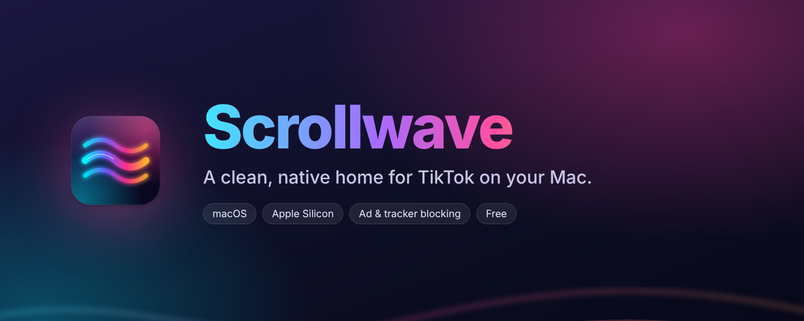
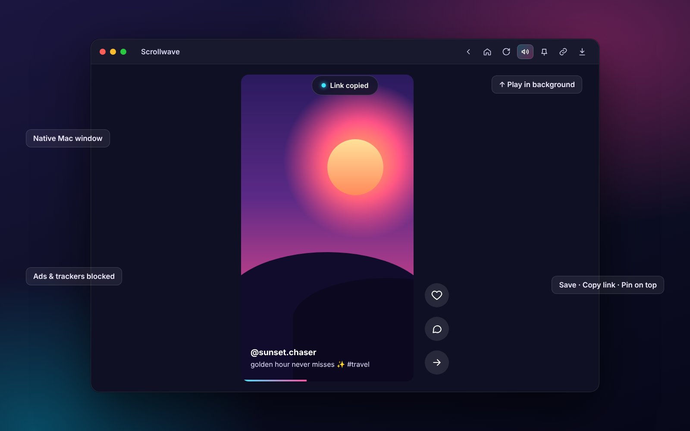
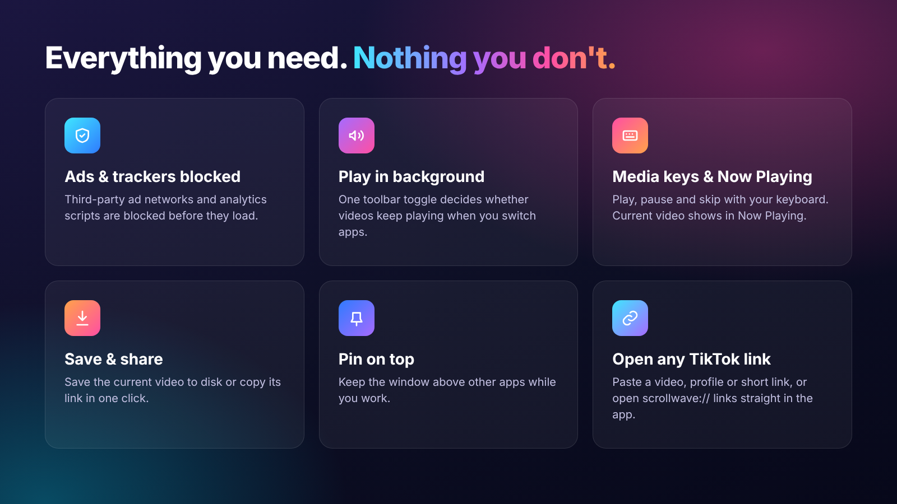

  

  <a href="https://github.com/motareksamir/Scrollwave/releases/latest/download/Scrollwave.zip"><b>⬇︎ Download Scrollwave for macOS</b></a>
  &nbsp;·&nbsp;
  <a href="https://github.com/motareksamir/Scrollwave/releases">All releases</a>

  
  
  
  
  

---

**Scrollwave** puts TikTok in its own lightweight Mac window — no browser tabs, no clutter. It blocks third-party ads and trackers, plays nicely with your media keys, and lets you decide whether videos keep playing when you switch to another app.

  

## Features

  

- **Ads & trackers blocked** — third-party ad networks and analytics scripts are blocked before they load. (TikTok's own sponsored videos are part of the feed and aren't affected.)
- **Play in background** — a toolbar toggle: keep videos playing in other apps, or pause them when you leave Scrollwave. In Settings you can choose to pause only when the window is hidden or minimized.
- **Media keys & Now Playing** — play, pause and skip with your keyboard; the current video shows in Now Playing.
- **Save & share** — save the current video to disk or copy its link in one click.
- **Pin on top** — keep the window above other apps while you work.
- **Open any TikTok link** — paste a video, profile or short link, or open `scrollwave://` links straight in the app.
- **Pick up where you left off** — optionally reopen the last page on launch.
- **Privacy control** — *Sign Out and Clear TikTok Data* removes cookies, cache and saved site data in one step.

## Install

1. [Download **Scrollwave.zip**](https://github.com/motareksamir/Scrollwave/releases/latest/download/Scrollwave.zip) from the latest release.
2. Unzip it and drag **Scrollwave.app** into your **Applications** folder.
3. Open it and sign in to TikTok as usual.

Scrollwave is signed with a Developer ID and notarized by Apple, so it opens without Gatekeeper warnings.

### Requirements

- macOS 27.2 or later
- Apple Silicon Mac

## FAQ

**Is this an official TikTok app?**
No. Scrollwave is an independent app that shows the TikTok website inside a native macOS window. It is not affiliated with, endorsed by, or sponsored by TikTok or ByteDance.

**Where is my data stored?**
Your sign-in and site data stay on your Mac, in Scrollwave's own web storage. Scrollwave has no servers and collects no analytics. Use *Sign Out and Clear TikTok Data* to wipe everything.

**Why can't I save some videos?**
Some videos don't expose a downloadable file. In that case, use TikTok's own Download option.

## Feedback

Found a bug or have an idea? [Open an issue](https://github.com/motareksamir/Scrollwave/issues).

---

TikTok is a trademark of ByteDance Ltd. Scrollwave is not affiliated with TikTok or ByteDance.
